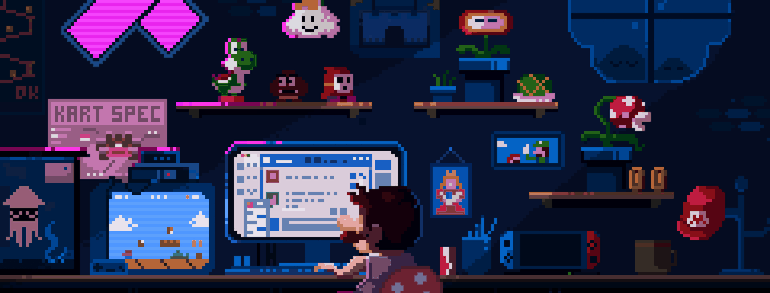

 

---

### 👋 About Me

🎓 **AI & Data Science** student at **Vishwakarma Institute of Technology, Pune**

🤖 Levelling up in **Machine Learning** and **Computer Vision**

🔭 Currently building **AI-powered tools** with Flutter, FastAPI and the MERN stack

🌱 Exploring **deep learning**, **system design** and **scalable backends**

🤝 Open to **collaborations, freelance work and open source**

📬 Reach me at **vikrantkthakur123@gmail.com**

 

---

### ⚡ Currently

<table align="center">
  <tr>
    <td align="center" width="33%">
      🔭 <b>Building</b> 
      AI-powered tools & full-stack apps
    </td>
    <td align="center" width="33%">
      🌱 <b>Learning</b> 
      Deep learning & system design
    </td>
    <td align="center" width="33%">
      💬 <b>Ask me about</b> 
      Python · React · OpenCV · C++
    </td>
  </tr>
</table>

---

### 🛠️ Tech Stack

<i>Languages • Web & App Development • AI / ML • Tools</i>

<table>
  <tr>
    <td align="center" width="100">
       <b>C</b>
    </td>
    <td align="center" width="100">
       <b>C++</b>
    </td>
    <td align="center" width="100">
       <b>JavaScript</b>
    </td>
    <td align="center" width="100">
       <b>Python</b>
    </td>
    <td align="center" width="100">
       <b>HTML5</b>
    </td>
    <td align="center" width="100">
       <b>CSS3</b>
    </td>
    <td align="center" width="100">
       <b>Tailwind</b>
    </td>
    <td align="center" width="100">
       <b>TypeScript</b>
    </td>
    <td align="center" width="100">
       <b>React</b>
    </td>
  </tr>
  <tr>
    <td align="center" width="100">
       <b>Node.js</b>
    </td>
    <td align="center" width="100">
       <b>Express</b>
    </td>
    <td align="center" width="100">
       <b>Flutter</b>
    </td>
    <td align="center" width="100">
       <b>Dart</b>
    </td>
    <td align="center" width="100">
       <b>React Native</b>
    </td>
    <td align="center" width="100">
       <b>Scikit-learn</b>
    </td>
    <td align="center" width="100">
       <b>OpenCV</b>
    </td>
    <td align="center" width="100">
       <b>Pandas</b>
    </td>
    <td align="center" width="100">
       <b>MongoDB</b>
    </td>
  </tr>
  <tr>
    <td align="center" width="100">
       <b>MySQL</b>
    </td>
    <td align="center" width="100">
       <b>Git</b>
    </td>
    <td align="center" width="100">
       <b>GitHub</b>
    </td>
    <td align="center" width="100">
       <b>Figma</b>
    </td>
    <td align="center" width="100">
       <b>Blender</b>
    </td>
    <td align="center" width="100">
       <b>Postman</b>
    </td>
    <td align="center" width="100">
       <b>Arduino</b>
    </td>
    <td align="center" width="100">
       <b>Power BI</b>
    </td>
  </tr>
</table>

---

### 🚀 Featured Projects

<table>
  <tr>
    <td width="50%" valign="top">
      <h3>🧠 <a href="https://github.com/Vikrant-K-Thakur/IntelliDoc">IntelliDoc</a></h3>
      
AI-powered document assistant to upload, read, summarize, translate and chat with your documents.

      

        
        
        
      

      <a href="https://github.com/Vikrant-K-Thakur/IntelliDoc">View Repository →</a>
    </td>
    <td width="50%" valign="top">
      <h3>🛒 <a href="https://github.com/Vikrant-K-Thakur/E-Commerce-Website">E-Commerce Website</a></h3>
      
Full-stack shopping platform with wallet & loyalty coins, secure checkout and an analytics dashboard.

      

        
        
        
      

      <a href="https://e-commerce-website-nine-wine.vercel.app">Live Demo →</a>
    </td>
  </tr>
  <tr>
    <td width="50%" valign="top">
      <h3>📷 <a href="https://github.com/Vikrant-K-Thakur/qr-attendance-system">QR Attendance System</a></h3>
      
Event attendance manager with QR scanning, real-time validation and duplicate prevention.

      

        
        
        
      

      <a href="https://github.com/Vikrant-K-Thakur/qr-attendance-system">View Repository →</a>
    </td>
    <td width="50%" valign="top">
      <h3>📐 <a href="https://github.com/Vikrant-K-Thakur/Product-Dimension-Measurement">Product Dimension Measurement</a></h3>
      
Computer vision system that measures product dimensions using dual-camera capture and OpenCV.

      

        
        
      

      <a href="https://github.com/Vikrant-K-Thakur/Product-Dimension-Measurement">View Repository →</a>
    </td>
  </tr>
</table>

  

---

### 📊 GitHub Stats

 

---

### 🕹️ Contribution Arcade

<picture>
  <source media="(prefers-color-scheme: dark)" srcset="https://raw.githubusercontent.com/Vikrant-K-Thakur/Vikrant-K-Thakur/output/pacman-contribution-graph-dark.svg">
  <source media="(prefers-color-scheme: light)" srcset="https://raw.githubusercontent.com/Vikrant-K-Thakur/Vikrant-K-Thakur/output/pacman-contribution-graph.svg">
  
</picture>

---

---

### 🤝 Connect With Me

---

<i>“Code. Learn. Build. Repeat.”</i>

  

